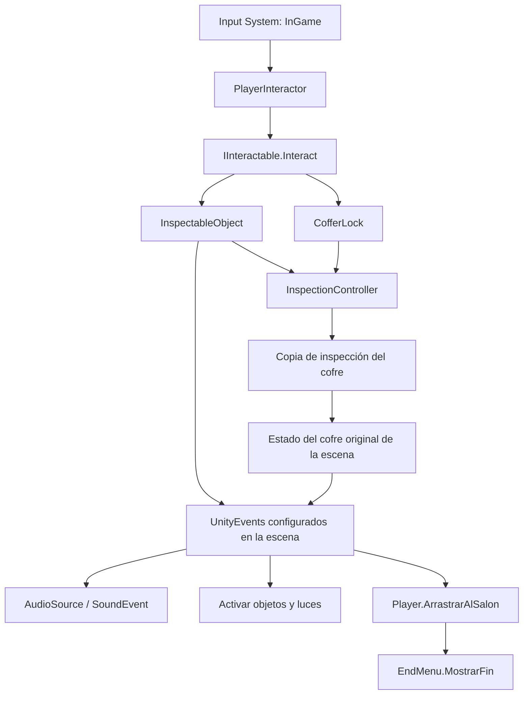

# Mapa técnico

He separado el proyecto por lo que hace cada parte: mover al jugador, detectar objetos, inspeccionarlos, resolver la caja y activar los eventos. Aquí explico dónde está cada cosa y qué tendría que revisar alguien que continúe el proyecto.

## Organización

| Ruta | Contenido |
|---|---|
| `Assets/Scenes/Intro.unity` | Menú e introducción animada; entrada a NightHouse |
| `Assets/Scenes/NightHouse.unity` | Casa, pistas, eventos y conexiones concretas de la partida |
| `Assets/Scenes/OutdoorsScene.unity` | Escena auxiliar, fuera de la build actual |
| `Assets/Scripts/Player` | Movimiento, interacción e interfaz común |
| `Assets/Scripts/InspectableObjects` | Datos de objetos, notas, visor y puzzle del cofre |
| `Assets/Scripts/Dialogue` | Disparadores y presentación de diálogos |
| `Assets/Scripts/Events` | Activación de eventos de zona y reproducción de audio |
| `Assets/Scripts/Scenes` | Introducción, pausa, menú final y balanceo de la introducción |
| `Assets/Prefabs` | Player, Note, CofferKey, InspectionSystem, GameMenus y GameAudio |
| `Assets/Assets` | Modelos, materiales, texturas, sonidos y tipografías |
| `Assets/Input` | Acciones del Input System |
| `Packages`, `ProjectSettings` | Dependencias y ajustes necesarios para abrir el proyecto |

`Library`, `Temp`, `Logs`, `obj` y `Builds` no forman parte de los fuentes versionados.

## Responsabilidades

| Componente | Responsabilidad y configuración relevante |
|---|---|
| `Player` | Rigidbody, velocidad y suavizado; cámara; balanceo y audio al caminar; arrastre final. Campos `cameraPivot`, `walkCamera`, `footsteps`, `dragTarget`, `dragDuration`; evento `onDragFinished` |
| `PlayerInteractor` | Raycast desde el centro de la cámara, alcance de interacción y aviso visual. Busca `IInteractable` en el collider o sus padres |
| `IInteractable` | Contrato `Interact()`, compartido por `InspectableObject` y `CofferLock` |
| `InspectableObject` | Ejecuta `onInteracted` y abre su `ItemDefinition` en el visor |
| `ItemDefinition` | ScriptableObject con `itemName`, `description`, `inspectionPrefab` e `initialRotation` |
| `ItemDescriptionText` | Recibe un ItemDefinition y aplica su descripción al Text asignado mediante `SetItem()` |
| `InspectionController` | Instancia una copia del objeto, la centra, escala y representa en una RenderTexture. Gestiona giro, zoom, cierre y clics del cofre |
| `CofferLock` | Tres imágenes seleccionadas, habilitación de la tercera rueda, validación, tapa, llave y eventos del cofre |
| `MapEventTrigger` | BoxCollider de zona; invoca `onTriggered` al entrar un Player, con repetición opcional |
| `DialogueTrigger` | Texto y duración configurables; evento dinámico `onDialogue(string, float)`; activación por entrada o por `PlayDialogue()` |
| `DialogueUI` | Cola de mensajes y fundidos con tiempo no escalado |
| `SoundEvent` | `Play()` y `Stop()` para un AudioSource. Los bucles no se reinician si ya están sonando; los efectos puntuales utilizan PlayOneShot |
| `IntroController` | Fundidos, estado del menú, Animator y carga asíncrona de NightHouse |
| `IntroAnimationEvents` | Comunica al IntroController el final de la animación |
| `CameraSway` | Balanceo de cámara utilizado en la introducción, separado del efecto al caminar |
| `PauseMenu` | Pausa mediante Time.timeScale; reanudación y salida de la aplicación |
| `EndMenu` | Bloquea el juego, funde a negro y presenta reinicio o vuelta a Intro |

## Comunicación y flujo

Los eventos de los interactuables se invocan antes de abrir la inspección. Los callbacks se configuran en el Inspector. Los botones del candado tienen sus funciones asignadas en **On Click**, con índices 0, 1 y 2; el script no mantiene arrays de botones.

### Visor y estado de la caja

La vista previa es una instancia temporal del prefab, no el cofre original. `PreparePreview(original)` conserva una referencia a la instancia de la escena. La propiedad interna `State` permite que las ruedas, la resolución y la recogida modifiquen ese estado original. Destruir la vista previa al pulsar Esc no vuelve a cerrar el cofre ni hace reaparecer la llave.

Solo la cámara de inspección debe ver la capa **Inspection**. `SetupModel()` asigna esa capa y desactiva las colisiones de los objetos normales. En el caso del cofre habilita MeshColliders para comprobar qué pieza recibe el clic. El clic de pantalla se transforma a coordenadas de la RawImage y después a un rayo de la cámara de inspección.

El visor está acoplado específicamente a `CofferLock`: no es todavía una API genérica para cualquier puzzle 3D.

## Dónde se mantiene el estado

| Estado | Propietario | Reinicio |
|---|---|---|
| Controles y arrastre ya iniciado | `Player` | Nueva instancia al recargar la escena |
| Últimas imágenes elegidas, tercera rueda, cofre resuelto y llave recogida | `CofferLock` original | Nueva instancia; no se escribe en un guardado |
| Disparador de zona ya ejecutado | `MapEventTrigger.hasTriggered` | Nueva instancia |
| Diálogo ya activado | `DialogueTrigger.hasTriggered` | Nueva instancia |
| Cola de diálogos | `DialogueUI` | Se vacía al desactivar el componente o recargar |
| Final iniciado | `EndMenu.ending` | Nueva instancia |
| Luces, muebles y zonas activas | GameObjects de la escena, mediante eventos | Valores serializados al recargar |

`ItemDefinition` almacena contenido, no progreso. No existe inventario visual, guardado persistente ni controlador central de progresión. La salida se habilita mediante callbacks de `onKeyCollected`; no mediante un script genérico de puerta que consulte un inventario.

## Decisiones y límites

- La interfaz de interacción permite añadir otro comportamiento sin modificar el raycast del jugador.
- Los ScriptableObjects separan pistas y prefabs de su presentación. Una nota nueva puede reutilizar Note y el mismo visor.
- Los UnityEvents permiten configurar audio, luces y progreso en la escena. Su coste es que hay que revisar destinos, argumentos y llamadas duplicadas; algunas conexiones no se ven leyendo solo los scripts.
- Los booleanos locales evitan repetir apertura, recogida y final. No garantizan por sí solos que toda una secuencia de eventos de una nota se ejecute una sola vez.
- `Player` reúne locomoción, efectos de cámara y arrastre final. En una ampliación mayor convendría separar la secuencia final y los efectos de movimiento.
- La recarga de escena es el mecanismo de reinicio. La autora lo ha probado en la build definitiva; no hay una función global que restablezca manualmente cada sistema.
- La introducción espera a `FinishIntro()`. Si se elimina el evento de animación o cambia el nombre de estado `IntroAnim`, la transición puede quedar esperando.
